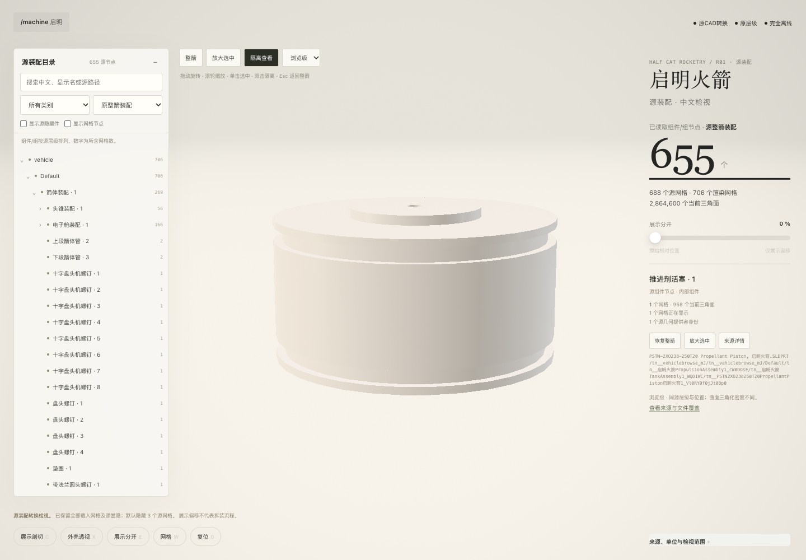
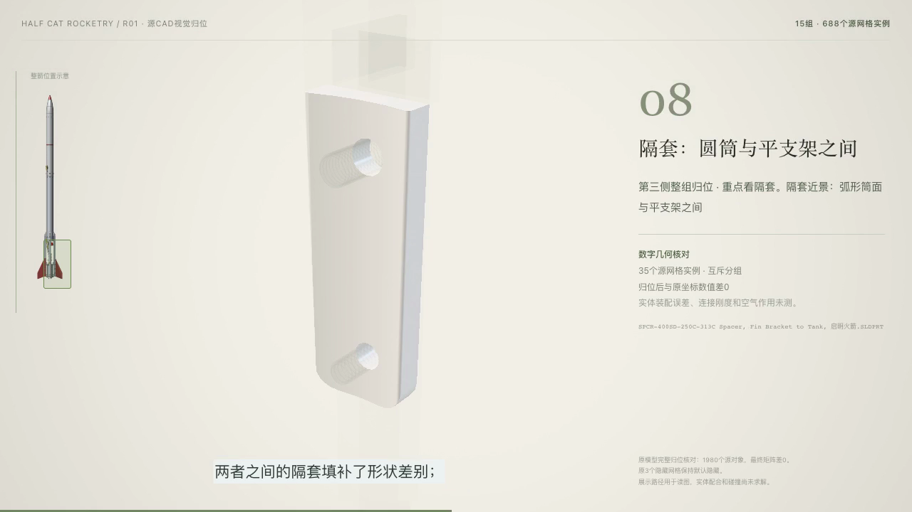

# 启明火箭 · 源CAD数字复现

原设计归属 **Half Cat Rocketry**，“启明火箭”为中文展示名称。本项目提供原CAD可视化、逐件图册、可编辑Blender场景、来源身份与实际QA；内部原始文件名与来源记录保持不变。展示归位顺序不构成实体施工、配合约束、动力系统或飞行可靠性验证。

仓库保存可编辑文本源码、来源/许可说明、恢复工具及完整交付的逐文件SHA256清单。大型模型、原始工程392文件快照、预览图、USD/GLB/Blend、媒体和大型QA数据由同版本Release附件提供；仅下载GitHub自动生成的“Source code.zip”不会得到完整模型。





## 获取完整视觉工程

下载同一Release全部 `qiming-visual-*.tar.gz`、`release-manifest.json`、`assets.json`、`SHA256SUMS`。需要旁白时，另外下载独立的 `qiming-audio-noncommercial-*.tar.gz`。将附件放入一个目录，用仓库的验证器在新目录中展开：

```sh
python3 verify_release.py --asset-dir ./downloads --root ./recovered --extract
```

此命令会先核对每个附件大小与SHA256，再核对全部展开文件与原392文件快照。它拒绝越界路径和覆盖已经改变的本地文件，不删除文件。视觉包的两个主要入口是：

只下载视觉包时，在命令后加 `--layer visual`；之后补齐独立音轨包可再次按完整层核验。

- `recovered/outputs/启明火箭/打开项目.html`
- `recovered/outputs/启明火箭/整箭原件检视.html`

影片及十五组交互页在公开视觉包中为**无声版**，保留真实6051帧、烧录字幕与画面；视觉模型不附加非商业限制。各部件的源文件记录、实例数、BOM行数是不同口径，不能视为同一零件数量。

## 在本地恢复完整讲解

声音是独立的Breeze2自托管输出，限研究与非商业使用。它没有被改授MIT/GPL，也没有给GPL视觉素材附加非商业条件。下载独立音轨包后，可在自己的机器上恢复：

```sh
python3 restore_local.py --root ./recovered --destination ./restored-lecture --noncommercial-research
```

需要Python3、ffmpeg、ffprobe。此操作不调用TTS、不联网、不重新处理音量、不改变声音速度，也不修改已核验的下载包。交互HTML按独立MP3重新嵌入，可恢复原始HTML字节；MP4直接复合原视频和独立AAC包，核对视频/音频编码包SHA256、6051帧与全流解码。MP4容器字节不保证相同。

恢复工具的技术通过不等于实际浏览/试听验收。应实际打开恢复后的HTML，测试播放、章节、拖动、字幕、声音与几何，并播放MP4后再判断完整性。

## 修改与重建

主检视页面：`outputs/启明火箭/source/assembly-viewer/REBUILD.md`。固定依赖Three.js0.170.0、esbuild0.27.7；可执行内存构建验证而不生成大HTML。

交互影片：`outputs/启明火箭/source/assembly-film/REBUILD.md`。含真实语音时间与源几何，可本地重建；公开视觉页不含音频，完整有声版只在本地通过独立音轨恢复。

Blender动画：先将本仓库 `rebuild/` 目录复制到 recovered 根，再运行：

```sh
python3 prepare_blender_rebuild.py --root ./recovered
```

这会为现存Blender重建脚本生成相对路径副本，连接包内源Blend、USD、元数据和附MIT许可的Scenario动画helper。原始已交付脚本、网格和Blend不改。实际验证版本为Blender5.2.2 LTS（build d13f752e3b9c），可用相同或兼容版本；旧Blender4.4.3不能读取该5.x文件。实际重建需另外运行生成的脚本并重新做坐标/画面QA，不能把准备成功写成重建成功。

图卡编辑源在 `outputs/启明火箭/source/component-illustrations/`：62个场景分别对应17原料、22手册、15功能和8来源图卡。发布副本将文字转为原字体实际求值的网格轮廓，保留原文、排版参数、生成脚本与实际图片输入映射；不附带Apple字体软件。几何与布局仍可编辑，重新排字需自行采用有相应许可的字体。这些图卡场景数不代表新增实体零件数。

## 来源与许可

完整分层见 [LICENSES.md](LICENSES.md)。原工程及派生CAD/视觉保留Half Cat Rocketry署名与GPL3条款；Machine/Three与Scenario helper保留各自MIT许可。Breeze源码Apache2.0与模型/自托管输出的研究非商业条款分开记录。独立聚合包没有统一的“全部MIT”或“全部非商业”许可。

本次转换将源曲面三角化，保留源层级、实例、变换和隐藏件；不称数学无损。原MassVolume保留其简化形体，未凭空构造伞布或内部细节。源中没有的信息不补造为制造、检验或飞行证据。

## 发布后实际验收

已从公开Release重新下载、校验、恢复声音、实际浏览播放并重建Blender和前端，见[真实下载与重建验收](docs/下载重建验收-v1.0.0.md)。原标签检查脚本的图纸空灯箱选择器已在主分支修正；报告保留原失败与精确差异。

已完成发布后的实际下载、离线播放与重建验收，并按授权清理本任务大型本地副本；原始项目和跨项目输入保留。见[本地清理记录](docs/本地生成副本清理-v1.0.0.md)。

剩余轻量工作源码与历史审计文本另有[补充归档](audit-archive/remaining-local-20261019/README.md)；剩余本地副本的最终状态见[收尾记录](verification/remaining-local-cleanup/receipt.json)。早期清理记录中的逐帧诊断图保留状态，以此最新收尾记录为准。
